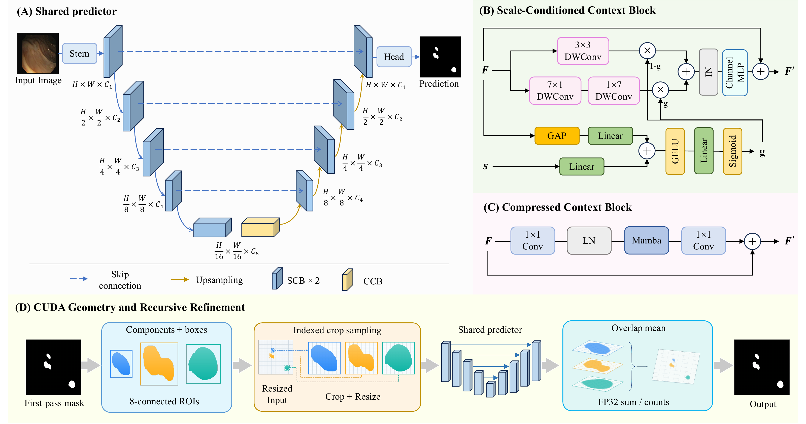

<h1 align="center">ReScale</h1>
<h3 align="center">Scale-Aware Recursive Medical Image Segmentation</h3>

<p align="center">Official PyTorch implementation</p>

<p align="center">
  
  
  
  
</p>

<p align="center">
  <a href="#overview">Overview</a> ·
  <a href="#installation">Installation</a> ·
  <a href="docs/data.md">Datasets</a> ·
  <a href="https://drive.google.com/file/d/1atRxU_ITdydcsXpQTZu9-yJ-6-MrFV-t/view?usp=drive_link">Model weights</a> ·
  <a href="#quick-start">Quick start</a> ·
  <a href="#code-structure">Code structure</a>
</p>

## Overview

ReScale brings **global localization and focused refinement into one shared network**.
Each crop carries its relative width and height, allowing the predictor to account
for scale changes after resizing. Custom CUDA kernels accelerate region extraction,
sampling and reconstruction; CUDA graph replay reduces inference overhead.



Each blue stage contains two blocks; the finest-resolution encoder and decoder stages use local-only variants.

## Installation

Set up a Python 3.10 environment on Linux with the CUDA 11.8 toolkit (`nvcc`)
and a C++ compiler, then install the dependencies:

```bash
python -m pip install torch==2.1.0 torchvision==0.16.0 --index-url https://download.pytorch.org/whl/cu118
python -m pip install packaging ninja wheel
python -m pip install --no-build-isolation -r requirements.txt
```

The custom kernels compile automatically on first use.

## Quick start

Run these commands from the project folder. See [Data preparation](docs/data.md)
for where to put your images and masks.

### 1. Prepare a dataset

```bash
python prepare_data.py --dataset CVC-ClinicDB --root /path/to/CVC-ClinicDB
```

This records your local file paths and checks the supplied five-fold splits.
All six datasets use [`configs/rescale.yaml`](configs/rescale.yaml).
Choose a dataset with `--dataset`: `CVC-ClinicDB`, `ISIC2018`, `BUSI`,
`PAPILA`, `PTX498` or `FUSeg2021`. Data and training-output paths are set automatically.

### 2. Train

```bash
torchrun --standalone --nproc_per_node=2 train.py \
  --dataset CVC-ClinicDB --fold 0
```

Repeat with folds `0`–`4` to run all five folds. Training samples one ROI per image;
validation and inference refine all retained ROIs. Validation runs from epoch 1.
Starting at epoch 50, validation Dice determines which checkpoint is saved as
`checkpoint_best.pth`.

### 3. Evaluate

```bash
python evaluate.py --dataset CVC-ClinicDB --fold 0 \
  --checkpoint outputs/CVC-ClinicDB/ReScale_fold0/checkpoint_best.pth
```

### 4. Predict

```bash
python predict.py \
  --checkpoint outputs/CVC-ClinicDB/ReScale_fold0/checkpoint_best.pth \
  --image /path/to/image.png --output outputs/prediction.png --graph
```

This saves a 256 × 256 binary mask using CUDA graph replay.

## Code structure

<details>
<summary>Browse the project layout</summary>

```text
ReScale/
├── train.py                  # Train one fold
├── evaluate.py               # All-ROI checkpoint evaluation
├── predict.py                # Single-image prediction
├── prepare_data.py           # Bind paths; preserve folds
├── configs/rescale.yaml      # One config for all datasets
├── manifests/                # Expected image/mask pairs
├── splits/                   # Existing five-fold partitions
├── rescale/
│   ├── build.py              # Model construction
│   ├── models/               # Shared predictor, SCB and Mamba blocks
│   ├── recursion/            # Regions, crops and reconstruction
│   ├── ops/                  # CUDA/C++ kernels and build support
│   ├── data/                 # Loading, augmentation and resize caches
│   ├── engine/               # Training, losses and logging
│   ├── evaluation/           # Metrics and validation
│   ├── inference/            # Graph capture and segmented replay
│   └── utils/                # Runtime settings
├── tests/                    # Project checks
├── tools/                    # Two-epoch run comparison
└── docs/                     # Dataset guide and overview image
```

</details>
